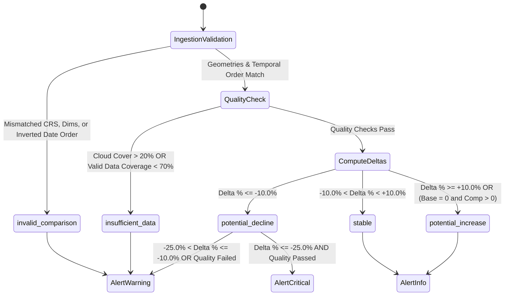

# System Architecture Specification: Micro-Reservoir Intelligence
## High-Performance, CPU-Bound Satellite Water Extent Monitoring Pipeline

---

## 1. Architectural Overview & Design Philosophy

**Micro-Reservoir Intelligence** is designed as a modular, stateless, CPU-efficient geospatial analytics system. The system ingests optical multispectral satellite imagery, extracts surface-water features, calculates physical ground surface area, and performs multi-temporal change detection to identify potential reservoir storage depletion.

### Core Architectural Principles
1. **Zero External API / Zero GPU Dependency at Runtime**: The core analytical engine operates 100% locally on standard CPU laptop hardware. It requires no GPU accelerators, CUDA runtimes, external machine learning services, cloud credits, or relational database servers.
2. **Stateless Functional Processing**: Core scientific functions (`validate_observation`, `detect_water`, `estimate_area`, `compare_observations`) are pure, deterministic, and stateless. Given identical raster arrays and metadata, they produce identical outputs.
3. **Strongly-Typed Contracts**: All inter-module communication is mediated through immutable or strictly typed Python dataclasses (`schemas.py`), eliminating untyped dictionary parsing bugs.
4. **Geospatial Rigor**: The pipeline enforces coordinate system standards, requiring planar projected coordinate reference systems (e.g., UTM) for metric area calculations and rejecting unprojected angular degree coordinate systems (e.g., `EPSG:4326`).
5. **Memory Containment**: To prevent out-of-memory crashes on resource-constrained laptops, rasters are limited to $25,000,000$ pixels (`max_pixel_limit`).
6. **Data Honesty by Design**: Mixed-pixel uncertainties are calculated and reported; unverified decline alerts are suppressed when quality checks fail; and synthetic demonstration scenarios are prominently distinguished from verified satellite data.

---

## 2. High-Level Data Flow Architecture

The end-to-end architecture connects satellite data ingestion, quality validation, spectral water extraction, physical quantification, change detection, alerting, and interactive presentation:

```mermaid
graph TD
    subgraph 1. Satellite Ingestion Layer
        S1[Sentinel-2 L2A BOA Reflectance] --> S2[Band 3: Green 560nm 10m]
        S1 --> S3[Band 8: NIR 842nm 10m]
        S4[Catalog STAC Search API] --> S5[download_mettur_sentinel2.py]
        S5 --> S6[Local GeoTIFFs: data/real_mettur/]
    end

    subgraph 2. Ingestion & Quality Pre-Flight
        S6 --> V1[geotiff.load_geotiff_observation]
        V1 --> V2[Path Safety Check: validate_safe_path]
        V1 --> V3[Header & Transform Check: read_geotiff_metadata]
        V1 --> V4[Grid Alignment Check: validate_grid_compatibility]
        V1 --> V5[Temporal Precedence: validate_temporal_order]
        V5 --> V6[Observation Dataclass]
    end

    subgraph 3. Spectral Water Extraction
        V6 --> W1[validation.validate_observation]
        W1 --> W2[water_detection.detect_water]
        W2 --> W3[compute_ndwi: Green - NIR / Green + NIR]
        W3 --> W4[Epsilon Guard: abs denom <= 1e-7]
        W4 --> W5[Strict Segmentation: Index > Threshold]
        W5 --> W6[WaterDetectionResult]
    end

    subgraph 4. Physical Area Quantification
        W6 & V6 --> A1[area_estimation.estimate_area]
        A1 --> A2[Verify Planar Projected CRS]
        A2 --> A3[Affine Determinant: det = |a*e - b*d|]
        A3 --> A4[Area = N_water * det: m², ha, acres]
        A4 --> A5[Boundary Uncertainty: ± sqrt N * det]
        A5 --> A6[AreaEstimate Dataclass]
    end

    subgraph 5. Dynamics & Alerting
        A6 & W6 --> C1[change_detection.compare_observations]
        C1 --> C2[Delta = Area_comp - Area_base]
        C2 --> C3[Delta % = Delta / Area_base * 100]
        C3 --> C4[Zero-Baseline Guard: Delta % = None]
        C4 --> C5[Categorical 2D Transition Mask]
        C5 --> C6[ChangeComparisonResult]
        C6 --> AL1[alerts.generate_alerts]
        AL1 --> AL2[Tiered Alerts: CRITICAL, WARNING, INFO]
    end

    subgraph 6. Presentation & Delivery
        C6 & AL2 --> R1[reporting.run_analysis]
        R1 --> R2[reporting.build_dashboard_data]
        R2 --> UI1[Streamlit App: app.py]
        R2 --> UI2[CLI Runner: scripts/run_demo.py]
        R2 --> EXP1[CSV Report Export: export_report_csv]
        R2 --> EXP2[JSON Report Export: export_report_json]
    end
```

---

## 3. Core Software Modules & Functional Contracts

### 3.1 Data Contracts Layer (`src/microreservoir/schemas.py`)
Provides the central data structures across the application:

- **`ObservationMetadata`**: Identifies a single satellite observation scene:
  - `scene_id` (`str`): Unique scene identifier (e.g., `REAL_METTUR_2026-08-30`).
  - `date` (`str`): Acquisition date in strict ISO-8601 calendar format (`YYYY-MM-DD`).
  - `sensor` (`str`): Constellation name (default: `"Sentinel-2"`).
  - `pixel_resolution_m` (`float`): Ground resolution in linear meters (nominal: `10.0`).
  - `crs` (`str`): Coordinate Reference System identifier (e.g., `"EPSG:32643"`).
  - `bounds` (`Tuple[float, float, float, float]`): Spatial bounding box coordinates.
  - `cloud_cover_percent` (`Optional[float]`): Cloud cover percentage.
  - `cloud_assessed` (`bool`): Boolean flag indicating whether cloud obscuration was verified.
  - `transform` (`Optional[Tuple[float, ...]]`): Six-element affine transform tuple.
  - `dimensions` (`Optional[Tuple[int, int]]`): Spatial array shape `(height, width)`.

- **`Observation`**: The primary multispectral payload:
  - `metadata` (`ObservationMetadata`): Scene metadata.
  - `bands` (`Dict[str, np.ndarray]`): Map of band identifiers (`green`, `nir`, `swir1`, `red`, `blue`) to 2D float32 arrays.
  - `valid_mask` (`Optional[np.ndarray]`): 2D boolean array where `True` indicates a valid pixel.

- **`WaterDetectionResult`**: Extracted surface water mask:
  - `water_mask` (`np.ndarray`): 2D boolean array (`True` for water).
  - `index_map` (`np.ndarray`): 2D continuous float32 index map strictly bounded in `[-1.0, 1.0]`.
  - `index_method` (`WaterIndexMethod`): Method used (`NDWI`, `MNDWI`, `AWEI`).
  - `threshold` (`float`): Applied cutoff value (default: `0.0`).
  - `water_pixel_count` (`int`): Count of positive water pixels.
  - `total_valid_pixels` (`int`): Count of valid non-masked pixels.
  - `water_fraction` (`float`): Ratio of water pixels to valid pixels.
  - `summary_statistics` (`Dict[str, float]`): Min, max, mean, standard deviation, and median.

- **`AreaEstimate`**: Quantified physical surface area:
  - `pixel_count` (`int`): Number of valid water pixels.
  - `pixel_resolution_m` (`float`): Ground resolution in meters.
  - `pixel_area_m2` (`float`): Area per pixel derived from affine determinant.
  - `water_area_m2` (`float`): Total water extent in square meters.
  - `water_area_hectares` (`float`): Total water extent in hectares ($m^2 \times 10^{-4}$).
  - `water_area_acres` (`float`): Total water extent in international acres.
  - `uncertainty_range_hectares` (`Tuple[float, float]`): Lower and upper confidence bounds.
  - `is_available` (`bool`): `True` if CRS is projected; `False` if unprojected geographic degrees.

- **`ChangeComparisonResult`**: Bi-temporal comparison between two observations:
  - `baseline_id`, `baseline_date`: Baseline metadata.
  - `comparison_id`, `comparison_date`: Comparison metadata.
  - `baseline_area_ha`, `comparison_area_ha`: Water extent in hectares.
  - `area_delta_ha`: Net change in hectares.
  - `area_delta_percent`: Relative percentage change, or `None` if baseline is zero.
  - `status`: Central status (`stable`, `potential_decline`, `potential_increase`, `insufficient_data`, `invalid_comparison`).
  - `confidence_score` (`float`): Confidence score from 0.0 to 1.0.
  - `change_mask` (`Optional[np.ndarray]`): 2D categorical transition array.

- **`AlertItem`**: Actionable advisory alert:
  - `severity` (`AlertSeverity`): Operational tier (`CRITICAL`, `WARNING`, `INFO`).
  - `title` (`str`), `message` (`str`): Human-readable notification.
  - `action_recommended` (`str`): Actionable field advice.

---

### 3.2 Ingestion & Raster Validation Layer (`src/microreservoir/geotiff.py`)
Responsible for reading GeoTIFF rasters using Rasterio and GDAL:

```
[User Path Input]
       │
       ▼
[validate_safe_path] ──> Checks null bytes (\0), directory traversal (../)
       │
       ▼
[read_geotiff_metadata] ──> Validates size > 0, non-null CRS, non-degenerate transform,
       │                    checks pixels <= max_pixel_limit (25,000,000)
       ▼
[load_geotiff_observation] ──> Ingests single-band files or multiband file with 1-indexed mapping,
       │                       enforces matching shape and CRS across bands,
       │                       constructs valid_mask excluding NoData and cloud
       ▼
[validate_grid_compatibility] ──> Asserts matching CRS, dimensions, resolution, and affine origins
```

---

### 3.3 Spectral Water Extraction Layer (`src/microreservoir/water_detection.py`)
Computes spectral water indices via vectorized NumPy C-routines:

- **McFeeters NDWI**:
  $$\text{NDWI} = \frac{\rho_{\text{Green}} - \rho_{\text{NIR}}}{\rho_{\text{Green}} + \rho_{\text{NIR}}}$$
- **Xu MNDWI**:
  $$\text{MNDWI} = \frac{\rho_{\text{Green}} - \rho_{\text{SWIR1}}}{\rho_{\text{Green}} + \rho_{\text{SWIR1}}}$$
- **Feyisa AWEI (Non-Shadow)**:
  $$\text{AWEI} = 4 \times (\rho_{\text{Green}} - \rho_{\text{SWIR1}}) - (0.25 \times \rho_{\text{NIR}} + 2.75 \times \rho_{\text{SWIR2}})$$
- **Epsilon Denominator Protection**: Detects near-zero denominators ($|\text{denom}| \le 10^{-7}$) and assigns $0.0$.
- **NaN / Inf Quarantine**: Replaces unphysical radiometric values with $-1.0$ and clips the index array strictly to $[-1.0, 1.0]$.
- **Strict Inequality Segmentation**: Masks water pixels where $\text{Index} > \tau$ on valid pixels.

---

### 3.4 Physical Area Quantification Layer (`src/microreservoir/area_estimation.py`)
Converts pixel counts into physical units:

1. **CRS Projection Check**: Inspects `rasterio.crs.CRS.is_projected`. If CRS is geographic (degree-based, such as `EPSG:4326`), the area calculation is rejected or reported as unavailable (`is_available = False`).
2. **Affine Determinant Derivation**: Derives ground pixel area from the affine matrix determinant:
   $$\text{det} = |a \cdot e - b \cdot d|$$
3. **Unit Conversion**:
   $$\text{Area (m}^2\text{)} = N_{\text{water}} \times \text{det}$$
   $$\text{Area (ha)} = \text{Area (m}^2\text{)} \times 10^{-4}$$
   $$\text{Area (acres)} = \text{Area (m}^2\text{)} \times 0.000247105$$
4. **Boundary Mixed-Pixel Uncertainty**:
   $$\text{Uncertainty (ha)} = \max\left(1.0, \sqrt{N_{\text{water}}}\right) \times \text{det} \times 10^{-4}$$

---

### 3.5 Bi-Temporal Change & Alerting Layer (`src/microreservoir/change_detection.py` & `alerts.py`)

#### Central Status State Machine
Every bi-temporal comparison transitions into exactly one of five operational states:



#### Categorical 2D Transition Mask Classes
Change detection classifies every pixel in the observation grid into a categorical transition class:
- `NON_WATER (0)`: Land in both baseline and follow-up dates.
- `PERSISTENT_WATER (1)`: Water observed on both dates.
- `WATER_LOST (2)`: Water on baseline date, dry land on follow-up date (surface shrinkage).
- `WATER_GAINED (3)`: Dry land on baseline date, water on follow-up date (surface expansion).
- `INVALID (255)`: Invalid, NoData, or cloud-masked on either date.

---

## 4. Security, Memory Safety, and Error Containment

| Threat / Risk Vector | Implementation Guard | File Location | Exception Raised |
| :--- | :--- | :--- | :--- |
| **Path Traversal Attacks** | Rejects null bytes (`\0`), canonicalizes path, asserts `is_relative_to(base_dir)` | `geotiff.py:validate_safe_path` | `PathTraversalError` |
| **Out-of-Memory (Large Rasters)** | Limits pixel processing to $25,000,000$ pixels ($5000 \times 5000$) | `geotiff.py:read_geotiff_metadata` | `RasterReadError` |
| **Zero-Division in Math** | Epsilon check ($|\text{denom}| \le 10^{-7}$) assigns $0.0$; zero baseline sets delta % to `None` | `water_detection.py`, `change_detection.py` | Safe `None` / `0.0` |
| **Spatial Grid Misalignment** | Compares CRS, dimensions, resolution, and affine origins | `geotiff.py:validate_grid_compatibility` | `IncompatibleGridError` |
| **Temporal Sequence Inversion** | Validates ISO-8601 calendar date and asserts `baseline_date < comparison_date` | `geotiff.py:validate_temporal_order` | `TemporalOrderError` |
| **Missing / Degenerate CRS** | Validates non-null CRS; rejects angular degrees for planar area | `geotiff.py`, `area_estimation.py` | `MissingCRSError` |

---

## 5. Configuration Architecture

The application configuration is managed through `config.py:AppConfig`. Instances are immutable dataclasses (`frozen=True`) that can be instantiated with default values or overridden via environment variables or runtime dashboard sliders:

```python
@dataclass(frozen=True)
class AppConfig:
    environment: str = "development"
    log_level: str = "INFO"
    default_water_index: str = "NDWI"
    ndwi_threshold: float = 0.0
    decline_threshold_percent: float = -10.0
    critical_decline_threshold_percent: float = -25.0
    increase_threshold_percent: float = 10.0
    max_cloud_cover_percent: float = 20.0
    min_valid_pixel_ratio: float = 0.70
    max_pixel_limit: int = 25000000
    default_pixel_resolution_m: float = 10.0
    default_crs: str = "EPSG:32643"
```
